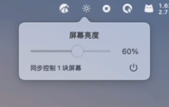

# BrightnessBar

<p align="center">
  
</p>

一款极简的 macOS 菜单栏亮度调节工具：一个太阳图标、一个滑杆，同步控制内置屏幕与
支持 DDC/CI 的外接显示器。从 [AetherSwitch](https://github.com/bcblr1993/AetherSwitch)（MIT）
的亮度功能精简重写而来，无任何第三方依赖。

A minimal macOS menu-bar brightness control: one sun icon, one slider, syncing the
built-in panel and DDC/CI-capable external displays at once. A slim rewrite of the
brightness feature of [AetherSwitch](https://github.com/bcblr1993/AetherSwitch) (MIT),
with zero third-party dependencies.

## 为什么做这个 / Why This Exists

**中文**：苹果对显示器亮度有个尴尬的设计——亮度键（F1/F2）和控制中心**只能调节内置
屏幕**。在 Mac mini 上根本没有亮度键；MacBook 外接显示器时，按键也只影响笔记本自带
的屏幕。也就是说，macOS 原生根本没有调节外接显示器亮度的入口。BrightnessBar 通过
DDC/CI 协议直接向显示器写入亮度值，把一个菜单栏滑杆变成所有屏幕的总控制器：内置屏
走系统接口，外接屏走 DDC/CI，各自映射到自身亮度范围，拖一次全部生效。

**English**: Apple only wires the brightness keys and Control Center to the *built-in*
display. A Mac mini has no brightness keys at all, and on a MacBook they never touch
an external monitor — macOS simply offers no native way to dim an external display.
BrightnessBar writes brightness straight to the monitor over DDC/CI and turns one
menu-bar slider into a master control for every screen: the built-in panel through the
system API, external monitors through DDC/CI, each mapped to its own brightness range.

演示视频 / Video demo: [assets/demo.mp4](assets/demo.mp4)

## 功能 / Features

- 菜单栏太阳图标，左键滑杆同步调节所有屏幕 / Menu-bar slider syncs every display
- 外接屏 DDC/CI（IOAVService），内置屏走系统接口 / External via DDC/CI, built-in natively
- 按 Mac 亮度键时外接屏自动跟随 / External displays follow the Mac brightness keys
- 插拔显示器自动识别 / Displays are re-detected on hotplug
- 右下角电源按钮退出 / Power button quits

## 构建 / Build（需 Xcode Command Line Tools）

```bash
cd BrightnessBar
chmod +x make-app.sh
./make-app.sh          # 产物 / output: build/BrightnessBar.app
```

也可以只跑 `swift build -c release`，直接运行 `.build/release/BrightnessBar`。

## 下载 / Download

- 安装包 / Package: [dist/BrightnessBar-1.0.1-arm64.dmg](dist/BrightnessBar-1.0.1-arm64.dmg)（仅 Apple Silicon，macOS 13+ / Apple Silicon only, macOS 13+）
- 或到 / Or visit: [Releases](https://github.com/Samuelonly/BrightnessBar/releases)

## 实现说明 / Implementation Notes

- 内置屏：DisplayServices 私有框架（`DisplayServicesGetBrightness` /
  `DisplayServicesSetBrightness[Smooth]`，运行时 dlopen）。
  Built-in: the private DisplayServices framework, resolved at runtime.
- 外接屏：IOKit 私有 `IOAVServiceCreateWithService` + `IOAVServiceReadI2C/WriteI2C`
  走 DDC/CI（枚举 `DCPAVServiceProxy` 且 `Location == External`；DCP29XX 面板使用
  0xB7 芯片地址）。External: private IOAVService IOKit calls over DDC/CI.
- 所有 I2C 通信在同一串行队列执行；滑杆拖动采用"最新值生效"合并。
  All I2C traffic is serialized; slider drags are coalesced, newest value wins.

## 与原版的取舍 / Trade-offs vs. the Original

- 没有原版"低亮度 Gamma 软件补偿"：外接屏 0% 只是显示器自身最低亮度，可能仍微微
  发光。No low-end gamma compensation: 0% stops at the monitor's own minimum.
- 没有外接屏写入的渐变动画，没有设置界面。No fade animation for external writes,
  no settings UI.

## 已知限制 / Known Limitations

- 外接屏需在显示器 OSD 菜单中开启 DDC/CI；部分转接器、虚拟屏、HDR 模式下硬件调节
  可能无效。External panels need DDC/CI enabled; some adapters, virtual displays and
  HDR modes won't respond.
- 使用了 Apple 私有框架接口，仅适合自用，不能上架 App Store。Private Apple APIs are
  used — fine for personal use, not App Store material.
- 同一百分比不代表各屏实际亮度（nits）相同。The same percentage is not the same nits
  across panels.

## 致谢 / Acknowledgements

- [AetherSwitch](https://github.com/bcblr1993/AetherSwitch)（MIT）——DDC/CI 报文格式、
  IOAVService 调用细节与 DisplayServices 私有 API 用法源自该项目。The DDC/CI packet
  format, IOAVService details and DisplayServices usage come from this project.
- [MonitorControl](https://github.com/MonitorControl/MonitorControl)——同类开源实现，
  DDC 思路参考。A similar open-source tool; inspiration for the DDC approach.

## 许可 / License

MIT，见 [LICENSE](LICENSE)。
